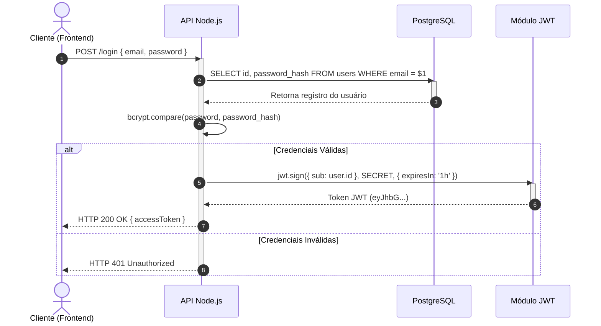

# Questão 1 — Fluxo Simples de Login (`Cliente → API Node.js → PostgreSQL → JWT`)

> **Enunciado:** *Desenhe (texto/PlantUML) um **fluxo simples** de login: cliente → API Node JS → PostgreSQL → JWT.*

* 📄 Versão em Texto ASCII puro: [`login-flow.txt`](./login-flow.txt)
* 🌱 Versão em PlantUML: [`login-flow.puml`](./login-flow.puml)

---

## Visualização Renderizada (Mermaid)

---

## Passo a Passo de Como Desenhar e Explicar

1. **Cliente → API Node.js (`POST /login`):** O cliente envia suas credenciais (`email` e `password`) no corpo da requisição via HTTPS.
2. **API Node.js → PostgreSQL (`SELECT`):** A API consulta a tabela `users` usando uma query parametrizada (`WHERE email = $1`) para buscar o `id` e o `password_hash`.
3. **Validação da Senha na API:** A API compara a senha enviada com o hash salvo no banco usando `bcrypt.compare()`.
4. **API Node.js → Módulo JWT (`jwt.sign`):** Se as credenciais forem válidas, a API gera um token JWT assinado contendo o identificador do usuário (`sub: user.id`) e o tempo de expiração (`exp`).
5. **Retorno ao Cliente:** A API devolve `HTTP 200 OK` com o `accessToken` JWT (ou `HTTP 401 Unauthorized` caso o e-mail não exista ou a senha esteja incorreta).
