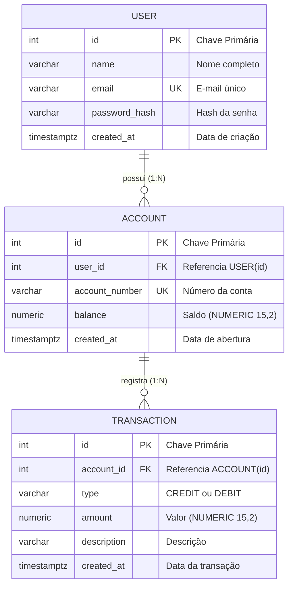

# Questão 2 — Modelagem ER (`User`, `Account`, `Transaction`)

> **Enunciado:** *Modele em **ER** (texto) as entidades **User, Account, Transaction** com chaves primárias/estrangeiras.*

* 📄 Versão em Texto ASCII puro: [`er-model.txt`](./er-model.txt)
* 🌱 Versão em PlantUML: [`er-model.puml`](./er-model.puml)
* 🗄️ Script DDL PostgreSQL: [`schema.sql`](./schema.sql)

---

## Visualização Renderizada (Mermaid ER)

---

## Explicação das Chaves e Relacionamentos

1. **`User` (`PK: id`):** Representa o cliente cadastrado no sistema.
2. **`Account` (`PK: id` | `FK: user_id → User.id`):** Relacionamento **`1:N`** (`User ||--o{ Account`), onde um usuário pode ter uma ou mais contas vinculadas, e cada conta pertence obrigatoriamente a um único `User`.
3. **`Transaction` (`PK: id` | `FK: account_id → Account.id`):** Relacionamento **`1:N`** (`Account ||--o{ Transaction`), onde uma conta registra zero ou várias transações financeiras ao longo do tempo (`CREDIT` ou `DEBIT`).
