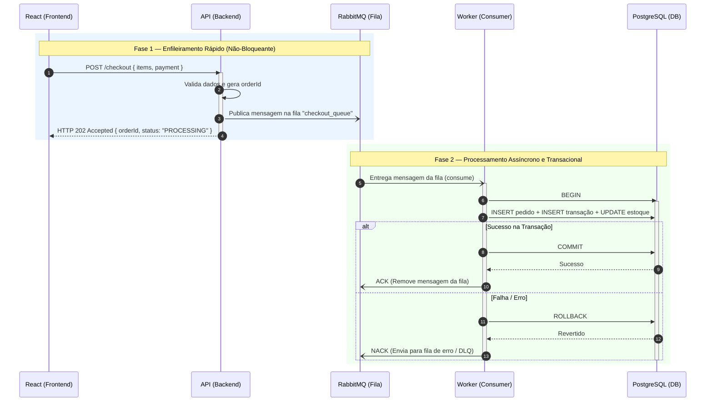

# Questão 3 — Diagrama de Sequência de Checkout (`React → API → RabbitMQ → Worker → PostgreSQL`)

> **Enunciado:** *Esboce (texto) um **diagrama de sequência** para um fluxo de "checkout" que envolve React → API → RabbitMQ → Worker → PostgreSQL.*

* 📄 Versão em Texto ASCII puro: [`checkout-sequence.txt`](./checkout-sequence.txt)
* 🌱 Versão em PlantUML: [`checkout-sequence.puml`](./checkout-sequence.puml)

---

## Visualização Renderizada (Mermaid)

---

## Passo a Passo do Fluxo

1. **`React → API`:** O frontend React envia `POST /checkout` com os itens do carrinho e dados de pagamento.
2. **`API → RabbitMQ`:** A API valida o contrato da requisição, gera o `orderId` e publica a mensagem na fila `checkout_queue` do RabbitMQ.
3. **`API → React` (`HTTP 202 Accepted`):** A API responde imediatamente ao usuário informando que o pedido foi aceito para processamento, sem travar a interface.
4. **`RabbitMQ → Worker`:** O Worker em background consome a mensagem da fila.
5. **`Worker → PostgreSQL`:** O Worker abre uma transação (`BEGIN`), grava o pedido e a transação financeira, atualiza o estoque e confirma com `COMMIT`.
6. **`Worker → RabbitMQ` (`ACK` / `NACK`):** Após o sucesso no PostgreSQL, o Worker envia `ACK` ao RabbitMQ para remover a mensagem da fila (ou faz `ROLLBACK` + `NACK` para a *Dead Letter Queue* em caso de erro).
